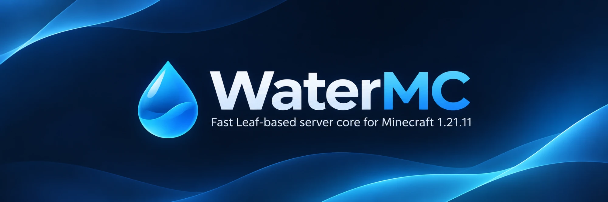

<div align="center">

[](https://github.com/s0nd3r-py/WaterMc/releases/latest)⠀
[](https://github.com/s0nd3r-py/WaterMc/releases)⠀
[](https://adoptium.net/)⠀
[](../../LICENSE.md)

**WaterMc** это форк [Leaf](https://github.com/Winds-Studio/Leaf) для Minecraft 1.21.11, настроенный на быструю генерацию мира, быстрый запуск и серверы с толпами мобов и игроков.
</div>

> [!WARNING]
> При первом запуске WaterMc переносит файлы сервера по новым папкам (`config/`, `data/`, `worlds/`). Сделайте бэкап **до** перехода.

[English](../../README.md) | **Русский**

## 💧 Возможности
- **Основан на [Leaf](https://github.com/Winds-Studio/Leaf)** (Paper → Purpur → Gale → Leaf): плагины Bukkit, Spigot и Paper работают без правок
- **Быстрее генерация мира**: больше чанков в секунду, чем у Leaf, и намного быстрее выбор точки спавна на новом мире
- **Быстрый запуск**: свой загрузчик, ленивый DataFixerUpper, маппинги грузятся только когда они нужны плагину
- **Толпы и фермы**: толкание в толпах мобов дешевле, кэш памяти мозга и поиск блоков из Lithium
- **Встроенные ViaVersion и ViaBackwards** (опция), свой экземпляр в `plugins/` всегда главнее
- **Скрытие сущностей за стенами** (опция): невидимые игроку сущности не отправляются, ESP-читы их не видят
- **Порядок в папке сервера**: `config/`, `data/`, `worlds/`, `logs/` вместо тридцати файлов в корне
- **Инструменты админа**: `/watermc inspect`, `/watermc drain`, watchdog плагинов и Netty, аудит безопасности, который называет плагин за каждой выдачей OP или командой от консоли
- **WaterScript**: встроенные скрипты с событиями, командами, таймерами и переменными
- **Исправления**: дюп через товар жителя (1.21.6+), портал и платформа Края игнорировали отмену `BlockDestroyEvent`

## 📥 Скачать
Свежая сборка в [GitHub Releases](https://github.com/s0nd3r-py/WaterMc/releases/latest). При первом запуске jar скачивает ванильный сервер с серверов Mojang и накладывает WaterMc поверх, как это делают Paper и Leaf.

```bash
java -Xms4G -Xmx4G -jar watermc-paperclip-1.21.11.jar --nogui
```

## 📄 Документация
- [Чем WaterMc отличается от Leaf](../../docs/about-watermc.md)
- [Новые ключи конфига в этом релизе](../../docs/release-description.md)
- [WaterScript](../../docs/scripting.md)

## 📦 Сборка
Изменения Minecraft хранятся патчами против Leaf, кода Mojang в репозитории нет. Нужны JDK 21 и Git.

```bash
./scripts/setup-source.sh      # Windows: .\scripts\setup-source.ps1
./gradlew :watermc-server:createMojmapPaperclipJar
```

## ⚖️ Лицензия
[GPL-3.0](../../LICENSE.md). Код из других проектов сохраняет свою лицензию и авторство: [`licenses/`](../../licenses), [`docs/inherited-attribution.md`](../../docs/inherited-attribution.md).
